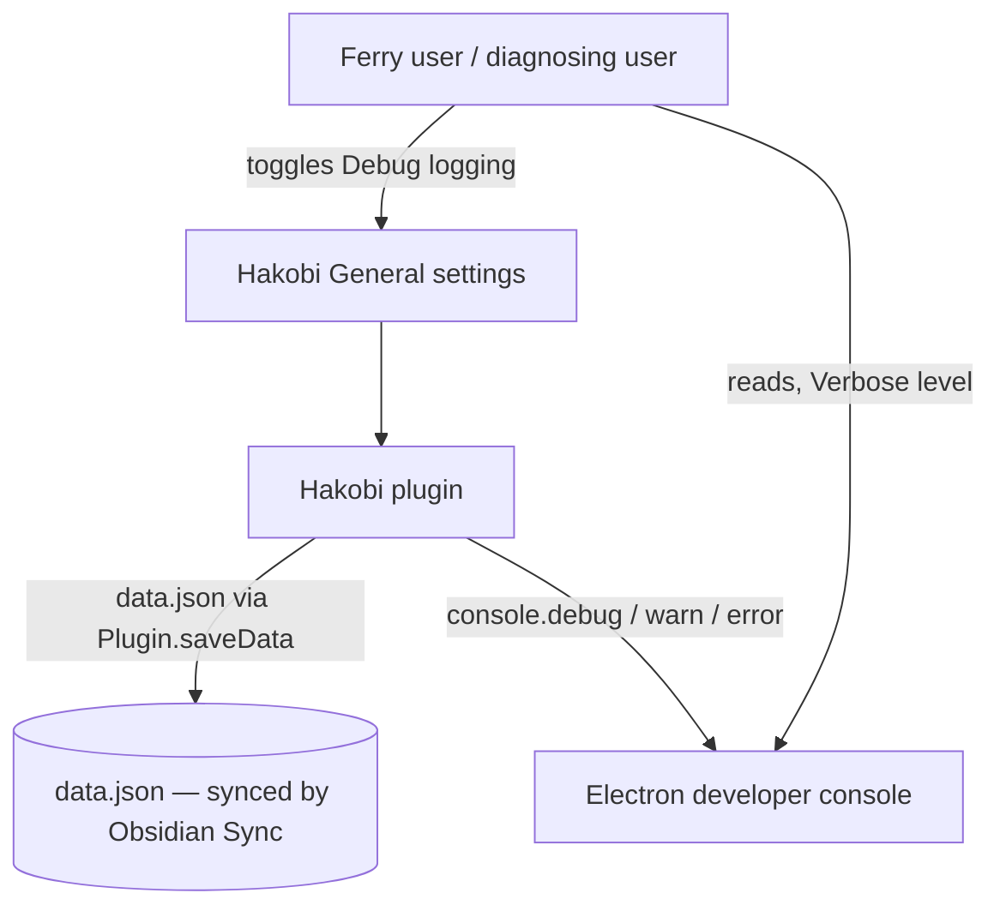
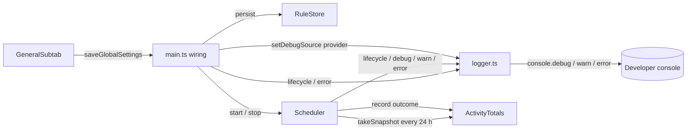
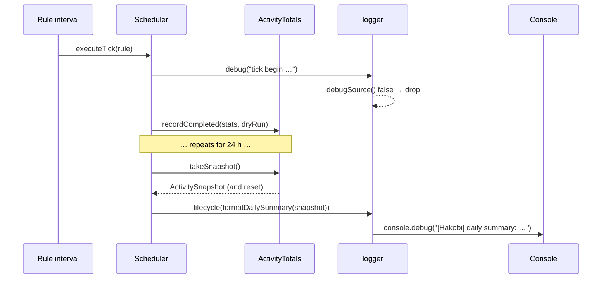

# Solution Design Document

## Validation Checklist

### CRITICAL GATES (Must Pass)

- [x] All required sections are complete
- [x] No [NEEDS CLARIFICATION] markers remain
- [x] Architecture pattern is clearly stated with rationale
- [x] **All architecture decisions confirmed by user**
- [x] Every interface has specification

### QUALITY CHECKS (Should Pass)

- [x] All context sources are listed with relevance ratings
- [x] Project commands are discovered from actual project files
- [x] Constraints → Strategy → Design → Implementation path is logical
- [x] Every component in diagram has directory mapping
- [x] Error handling covers all error types
- [x] Quality requirements are specific and measurable
- [x] Component names consistent across diagrams
- [x] A developer could implement from this design
- [x] Implementation examples use actual schema column names (not pseudocode), verified against migration files — *no database; examples use the real TypeScript field names from `src/types/index.ts` and `src/runner/RunStats.ts`*
- [x] Complex queries include traced walkthroughs with example data showing how the logic evaluates — *no queries; the totals counting logic has a traced walkthrough*

---

## Output Schema

### SDD Status Report

| Field | Type | Required | Description |
|-------|------|----------|-------------|
| specId | string | Yes | Spec identifier (NNN-name format) |
| architecture | ArchitectureSummary | Yes | Architecture overview |
| sections | SectionStatus[] | Yes | Status of each SDD section |
| adrs | ADRStatus[] | Yes | Architecture decision statuses |
| validationPassed | number | Yes | Validation items passed |
| validationPending | number | Yes | Validation items pending |
| nextSteps | string[] | Yes | Recommended next actions |

### ArchitectureSummary

| Field | Type | Required | Description |
|-------|------|----------|-------------|
| pattern | string | Yes | Selected architecture pattern |
| keyComponents | string[] | Yes | Main system components |
| externalIntegrations | string[] | No | External services integrated |

### SectionStatus

| Field | Type | Required | Description |
|-------|------|----------|-------------|
| name | string | Yes | Section name |
| status | enum: `COMPLETE`, `NEEDS_DECISION`, `IN_PROGRESS` | Yes | Current state |
| detail | string | No | What decision is needed or what's in progress |

### ADRStatus

| Field | Type | Required | Description |
|-------|------|----------|-------------|
| id | string | Yes | ADR identifier (e.g., ADR-1) |
| name | string | Yes | Decision name |
| status | enum: `CONFIRMED`, `PENDING` | Yes | Confirmation state |

---

## Constraints

- CON-1: TypeScript in strict mode, Obsidian desktop plugin (`isDesktopOnly: true`), esbuild bundle. No new runtime dependencies.
- CON-2: The `eslint-plugin-obsidianmd` recommended config only allows `console.debug`, `console.warn` and `console.error`. `console.info` and `console.log` count as lint errors. Timers must use `window.setInterval` (`obsidianmd/prefer-active-window-timers`) and be registered with `Plugin.registerInterval` so that unload cleans them up.
- CON-3: MiYo Constitution:
  - L1: no telemetry, all data stays local.
  - L2: logs and traces carry metadata only, never note content, frontmatter values, file bytes or credentials.
  - L1: the domain logic must be testable without Obsidian.
- CON-4: The audit log (`src/audit/`) and its closed `AuditEntry` allowlist stay unchanged (PRD, Won't Have).
- CON-5: TDD is mandatory in this repo (`src/CLAUDE.md`): a failing test comes before any production change.

## Implementation Context

**IMPORTANT**: You MUST read and analyze ALL listed context sources to understand constraints, patterns, and existing architecture.

### Required Context Sources

#### Documentation Context
```yaml
- doc: docs/XDD/specs/002-debug-logging-switch/requirements.md
  relevance: CRITICAL
  why: "Features F1-F5, 26 acceptance criteria, business rules for the daily summary"

- doc: docs/XDD/specs/001-v0-1/solution.md
  relevance: HIGH
  why: "Logging/Auditing section (~L1068, ~L1073-1077) says console = errors only; superseded by this spec (ADR-5)"

- doc: docs/ai/memory/decisions.md
  relevance: HIGH
  why: "Settings UI mirrors miyo-kado's IA — Developer heading + Debug logging toggle"

- doc: /Volumes/Moon/Coding/MiYo/Kado/src/settings/tabs/GeneralTab.ts (L289-310)
  relevance: MEDIUM
  why: "Reference wording/placement of Kado's debug toggle"

- doc: /Volumes/Moon/Coding/MiYo/Kado/docs/debug-logging.md
  relevance: MEDIUM
  why: "Reference structure for Hakobi's new docs/debug-logging.md"

- doc: PRIVACY.md, docs/troubleshooting.md (L80-95), docs/configuration.md (L13-20)
  relevance: HIGH
  why: "User docs to update (F4, F5)"
```

#### Code Context
```yaml
- file: src/util/logger.ts
  relevance: CRITICAL
  why: "Single log surface; gains the debug gate and the lifecycle channel"

- file: src/scheduler/Scheduler.ts
  relevance: CRITICAL
  why: "executeTick (L264-315) is the funnel for every run (timer, initial run, runOnce, runAll); owns timers via registerInterval; emits tick/load lines"

- file: src/runner/RunStats.ts
  relevance: HIGH
  why: "Per-run copied/skipped/failed counts, the input for the daily totals"

- file: src/types/index.ts (L53-58)
  relevance: HIGH
  why: "GlobalSettings, which gains debugLogging"

- file: src/persistence/RuleStore.ts (L51-56, L279-298)
  relevance: HIGH
  why: "DEFAULT_GLOBAL_SETTINGS and _mergeSettings per-field type check"

- file: src/settings/subtabs/GeneralSubtab.ts
  relevance: HIGH
  why: "Gets the Developer heading and toggle; _addNumericSetting must be narrowed to numeric keys"

- file: src/main.ts (L59-64, L67, L373-397, L471-510)
  relevance: HIGH
  why: "Initial globalSettings literal, load/unload lines, settings save wrapper, scheduler start/stop"

- file: test/__mocks__/obsidian.ts (L51-57, L130-135, L274)
  relevance: MEDIUM
  why: "registerInterval mock, _runCleanup, addToggle mock for UI tests"
```

#### External APIs (if applicable)
Not applicable. The feature has no external services. The only "external" surface is the Electron developer console, written to through `console.*`.

### Implementation Boundaries

- **Must Preserve**:
  - The `log.warn` / `log.error` behaviour, so failures stay visible without "Verbose".
  - The text of the tick lines, so debug output reads as it does today.
  - The audit log entries and their schema.
  - The status-bar behaviour.
  - The `executeTick` locking and audit semantics.
  - The `DeviceStore` warnings.
- **Can Modify**:
  - `logger.ts` API, adding functions. Existing callers keep compiling.
  - `Scheduler` constructor deps, with an optional new dep.
  - The `GeneralSubtab` layout and the type of `_addNumericSetting`.
  - The `main.ts` initial `globalSettings` literal, which may be replaced with `{ ...DEFAULT_GLOBAL_SETTINGS }` to remove a duplicated defaults block.
  - The General table in `docs/configuration.md`, including its known ms-vs-seconds and label drift, since it is touched anyway.
- **Must Not Touch**:
  - `src/audit/**`.
  - `src/domain/**` (scope logic).
  - The runners' per-file behaviour.
  - `manifest.json` id.
  - `docs/audit-log.md`. Its "operation: summary" drift is out of scope, and a separate issue is proposed.

### External Interfaces

#### System Context Diagram



#### Interface Specifications

```yaml
inbound:
  - name: "General settings toggle"
    type: Obsidian Setting UI (in-process)
    format: boolean
    authentication: n/a (local user)
    data_flow: "User sets debugLogging on/off; saved immediately"

outbound:
  - name: "Developer console"
    type: in-process console API
    format: plain text lines prefixed [Hakobi] / [Hakobi/Scheduler]
    authentication: n/a
    data_flow: "Lifecycle + daily summary at debug level (always); run detail at debug level (switch on only); failures at warn/error (always)"
    criticality: LOW

data:
  - name: "data.json (PluginData.globalSettings)"
    type: Obsidian Plugin.loadData/saveData
    connection: Obsidian vault adapter
    data_flow: "Persists debugLogging alongside the four numeric global settings"
```

### Cross-Component Boundaries (if applicable)

Not applicable. The change stays inside miyo-hakobi. No other MiYo component reads Hakobi's console output or settings, so no handoff and no Kokoro update is needed. Kado is used only as a UX reference.

### Project Commands

```bash
# Discovered from package.json / CLAUDE.md
Install: npm ci
Dev:     npm run dev
Test:    npm test            # vitest
Lint:    npm run lint        # eslint (obsidianmd) && stylelint styles.css
Build:   npm run build       # tsc -noEmit -skipLibCheck && esbuild production

# Database: not applicable
```

## Solution Strategy

- **Architecture Pattern:** keep the existing layered plugin: `main.ts` wires the pieces, the scheduler orchestrates, a pure domain helper does the counting, and the settings UI and persistence sit at the edges. Add one pure module (`ActivityTotals`) and extend the existing logger. No new layer.
- **Integration Approach:**
  - **Logger:** `logger.ts` gets a debug gate that reads a boolean provider registered once by `main.ts` (ADR-2), plus a `lifecycle` channel that is never gated (ADR-1).
  - **Scheduler:** it already funnels every run through `executeTick`. It records each run outcome in `ActivityTotals` and owns the 24-hour summary interval next to its per-rule intervals (ADR-3).
  - **Settings:** the switch is a new `GlobalSettings` field (ADR-4) and flows through the existing save wrapper.
- **Justification:**
  - Gating inside the logger keeps the "is debug on?" question in one place rather than at every call site.
  - The provider closure matches how `NodeFs` and `ImportRunner` already read live settings, so a stale value cannot occur.
  - The scheduler already sees every run outcome, so it is the cheapest place to observe them.
  - A pure counter keeps the business rules unit-testable without timers or Obsidian (Constitution L1).
- **Key Decisions:** ADR-1 to ADR-5 below.

## Building Block View

### Components



**Responsibility matrix (PRD → single owning component):**

| PRD requirement | Owner |
|---|---|
| F1 switch UI, description text (AC-1.1, 1.6) | GeneralSubtab |
| F1 persistence, default, sync (AC-1.4, 1.5) | RuleStore (GlobalSettings) |
| F1 takes effect without reload (AC-1.2, 1.3) | Logger (debug gate via provider) |
| F2 run lines only when switch on (AC-2.1, 2.5) | Logger (gate) + Scheduler call sites using `log.debug` |
| F2 load/unload events always (AC-2.2, 2.3) | Scheduler (config loaded, initial run) + main.ts (loading/loaded/unloading) using `log.lifecycle` |
| F2 failures always (AC-2.4) | Existing `log.warn` / `log.error` call sites (unchanged) |
| F2 console levels (AC-2.6) | Logger |
| F3 counting rules (AC-3.2, 3.3, 3.5) | ActivityTotals |
| F3 24 h cadence, zero summary, reload reset (AC-3.1, 3.4, 3.7) | Scheduler (summary interval) |
| F3 / F4 no names in summary (AC-3.6, 4.1) | ActivityTotals (`formatDailySummary` takes counts only) |
| F4 failure lines name the rule (AC-4.2), detail lines (AC-4.3) | Scheduler (existing call sites) |
| F4 PRIVACY.md section (AC-4.4), F5 docs (AC-5.x) | Docs |

### Directory Map

**Component**: miyo-hakobi plugin
```
.
├── src/
│   ├── util/
│   │   └── logger.ts                 # MODIFY: debug gate (setDebugSource), new log.lifecycle
│   ├── scheduler/
│   │   ├── ActivityTotals.ts         # NEW: pure in-memory counters + formatDailySummary
│   │   └── Scheduler.ts              # MODIFY: record outcomes, 24 h summary interval, lifecycle lines
│   ├── types/
│   │   └── index.ts                  # MODIFY: GlobalSettings.debugLogging
│   ├── persistence/
│   │   └── RuleStore.ts              # MODIFY: default + boolean merge for debugLogging
│   ├── settings/subtabs/
│   │   └── GeneralSubtab.ts          # MODIFY: Developer heading + toggle; numeric helper typed to numeric keys
│   └── main.ts                       # MODIFY: register/clear debug source; lifecycle lines; defaults via DEFAULT_GLOBAL_SETTINGS
├── test/
│   ├── util/logger.test.ts           # NEW
│   ├── scheduler/ActivityTotals.test.ts  # NEW
│   ├── scheduler/Scheduler.test.ts   # MODIFY: outcome recording, summary interval, quiet ticks
│   ├── settings/subtabs/GeneralSubtab.test.ts  # MODIFY: toggle
│   └── (RuleStore, types, example, spec/compliance, live helpers)  # MODIFY: GlobalSettings fixtures gain debugLogging
└── docs/
    ├── debug-logging.md              # NEW
    ├── troubleshooting.md            # MODIFY: Verbose + switch + per-OS shortcut
    ├── configuration.md              # MODIFY: new row; fix unit/label drift in the General table
    ├── XDD/specs/001-v0-1/solution.md  # MODIFY: superseded-by note on console rule (ADR-5)
    └── (root) PRIVACY.md, README.md   # MODIFY: console section; docs link
```

### Interface Specifications

#### Interface Documentation References

```yaml
interfaces:
  - name: "Logger module API"
    doc: src/util/logger.ts (header comment, updated)
    relevance: CRITICAL
    sections: [channel guidance]
    why: "Every console write goes through it; the channel guidance comment is the contract"

  - name: "Debug logging user guide"
    doc: docs/debug-logging.md (NEW)
    relevance: MEDIUM
    sections: [switch, Verbose level, lines per state]
    why: "User-facing contract for what appears in the console"
```

#### Data Storage Changes

```yaml
# data.json — PluginData.globalSettings (no schemaVersion bump; additive with default)
GlobalSettings:
  ADD FIELD: debugLogging (boolean, default false)
  MERGE RULE: typeof partial.debugLogging === "boolean" ? value : false
  # Existing files without the field load as false. Files written by this
  # version that are read by an older Hakobi: the older _mergeSettings drops
  # the unknown key (hand-listed fields), so a downgrade is harmless.
```

#### Internal API Changes

No HTTP endpoints. The module-level API changes are:

```yaml
Module: src/util/logger.ts
  setDebugSource(source: (() => boolean) | null): void   # NEW — null restores the default (debug off)
  log.debug(...args): void       # CHANGED — writes console.debug only when the source returns true
  log.lifecycle(...args): void   # NEW — always writes console.debug
  log.warn(...args): void        # unchanged — always console.warn
  log.error(...args): void       # unchanged — always console.error

Module: src/scheduler/ActivityTotals.ts (NEW)
  class ActivityTotals
    recordCompleted(stats: RunStats, dryRun: boolean): void
    recordFailed(): void
    recordOverlap(): void
    takeSnapshot(): ActivitySnapshot     # returns the current counts and resets them to zero
  formatDailySummary(s: ActivitySnapshot): string
  DAILY_SUMMARY_INTERVAL_MS = 86_400_000

Module: src/scheduler/Scheduler.ts
  SchedulerDeps.activityTotals?: ActivityTotals   # NEW optional dep; defaults to new ActivityTotals()
  start(): additionally schedules the summary interval (once)
  stop(): additionally cancels the summary interval
```

#### Application Data Models

```pseudocode
ENTITY: GlobalSettings (MODIFIED) — src/types/index.ts
  FIELDS:
    perFileTimeoutMs: number
    auditRetentionDays: number
    auditMaxBytes: number
    stabilityCheckMs: number
    + debugLogging: boolean (NEW, default false)

ENTITY: ActivitySnapshot (NEW) — src/scheduler/ActivityTotals.ts
  FIELDS:
    completedRuns: number   # non-dry runs that returned RunStats
    failedRuns: number      # runs whose runner threw (dry or not)
    overlapSkips: number    # ticks refused by the in-flight lock
    dryRuns: number         # dry runs that returned RunStats
    filesCopied: number     # sum of RunStats.copied over completedRuns
    filesSkipped: number    # sum of RunStats.skipped over completedRuns
    filesFailed: number     # sum of RunStats.failed over completedRuns
  BEHAVIORS: none (plain data)

ENTITY: ActivityTotals (NEW)
  FIELDS: private current: ActivitySnapshot
  BEHAVIORS: recordCompleted, recordFailed, recordOverlap, takeSnapshot (see above)
```

#### Integration Points

```yaml
- from: main.ts
  to: logger.ts
    - protocol: in-process function call
    - endpoints: setDebugSource(() => this.globalSettings.debugLogging) in onload; setDebugSource(null) in onunload
    - data_flow: "Live boolean read on every log.debug call"

- from: Scheduler
  to: ActivityTotals
    - protocol: in-process method calls
    - endpoints: recordCompleted/recordFailed/recordOverlap in executeTick; takeSnapshot in the summary interval
    - data_flow: "RunStats + outcome kind → counters → snapshot → formatted line"

- from: GeneralSubtab
  to: main.ts save wrapper → RuleStore
    - protocol: existing deps.ruleStore.saveGlobalSettings(next)
    - data_flow: "{ ...current, debugLogging } persisted; this.globalSettings updated, so the provider sees it immediately"
```

### Implementation Examples

#### Example: Gated logger

**Why this example**: it shows the single gating point, and that `lifecycle` and `debug` share `console.debug` but differ in gating.

```typescript
// Guidance, not prescriptive.
let debugSource: () => boolean = () => false;

export function setDebugSource(source: (() => boolean) | null): void {
	debugSource = source ?? (() => false);
}

export const log = {
	/** Per-run detail. Only when the user turned on Debug logging. */
	debug(...args: unknown[]): void {
		if (debugSource()) console.debug(...args);
	},
	/** Load/unload events and the daily summary. Always, at debug level. */
	lifecycle(...args: unknown[]): void {
		console.debug(...args);
	},
	warn(...args: unknown[]): void { console.warn(...args); },
	error(...args: unknown[]): void { console.error(...args); },
};
```

#### Example: Recording outcomes in executeTick

**Why this example**: every PRD counting rule maps onto exactly one branch of the existing method, and nothing else changes.

```typescript
// Inside Scheduler.executeTick — only the added lines are new.
if (!acquired) {
	this.activityTotals.recordOverlap();                         // Rule 4
	log.debug(`[Hakobi/Scheduler] tick skip: ${rule.name} (${rule.direction}) — overlap`);
	/* existing audit append + return */
}
try {
	const stats = await this.dispatchRunner(rule, dryRun);
	this.activityTotals.recordCompleted(stats, dryRun);          // Rules 2, 5
	/* existing setIdle + log.debug tick end */
} catch (err) {
	this.activityTotals.recordFailed();                          // Rule 3
	/* existing log.warn (unchanged, names the rule) + setFailed + audit */
}
```

#### Example: Traced walkthrough of a 24-hour period

**Why this example**: it confirms how dry runs, failures and overlaps combine, because they are the easiest rules to get wrong.

| # | Event during the period | completedRuns | failedRuns | overlapSkips | dryRuns | filesCopied | filesSkipped | filesFailed |
|---|---|---|---|---|---|---|---|---|
| 0 | plugin load / snapshot reset | 0 | 0 | 0 | 0 | 0 | 0 | 0 |
| 1 | initial run, rule A ok {copied 3, skipped 1, failed 0} | 1 | 0 | 0 | 0 | 3 | 1 | 0 |
| 2 | timer, rule B ok {0, 0, 2} (per-file failures) | 2 | 0 | 0 | 0 | 3 | 1 | 2 |
| 3 | timer, rule A overlaps (still running) | 2 | 0 | 1 | 0 | 3 | 1 | 2 |
| 4 | "Run now" dry run, rule B {would-write 5} | 2 | 0 | 1 | 1 | 3 | 1 | 2 |
| 5 | timer, rule A runner throws | 2 | 1 | 1 | 1 | 3 | 1 | 2 |
| 6 | 24 h mark → line written, counts reset | 0 | 0 | 0 | 0 | 0 | 0 | 0 |

Line at step 6:
`[Hakobi] daily summary: 2 runs, 1 failed, 1 overlap skip, 1 dry run; files 3 copied, 1 skipped, 2 failed`

Edge: with no events, the line reads `0 runs, 0 failed, 0 overlap skips, 0 dry runs; files 0 copied, 0 skipped, 0 failed` (AC-3.4). Plural forms are applied per count, and the line has no rule names (AC-3.6).

#### Test Examples as Interface Documentation

```typescript
describe("ActivityTotals", () => {
	it("keeps dry-run file results out of the file totals", () => {
		const t = new ActivityTotals();
		t.recordCompleted({ copied: 5, skipped: 0, failed: 0 }, true);
		expect(t.takeSnapshot()).toMatchObject({ dryRuns: 1, completedRuns: 0, filesCopied: 0 });
	});
	it("resets after a snapshot", () => {
		const t = new ActivityTotals();
		t.recordOverlap();
		t.takeSnapshot();
		expect(t.takeSnapshot().overlapSkips).toBe(0);
	});
});

describe("log.debug", () => {
	it("writes nothing until a source returns true, and follows it live", () => {
		const spy = vi.spyOn(console, "debug").mockImplementation(() => undefined);
		let on = false;
		setDebugSource(() => on);
		log.debug("x"); expect(spy).not.toHaveBeenCalled();
		on = true; log.debug("x"); expect(spy).toHaveBeenCalledTimes(1);
		setDebugSource(null);
	});
});
```

## Runtime View

### Primary Flow

#### Primary Flow: Quiet operation and the daily summary
1. Plugin loads. `main.ts` registers the debug source and writes the `plugin loading` lifecycle line.
2. `Scheduler.start()` schedules the rule intervals and the 24-hour summary interval, then writes `config loaded`.
3. Each run goes through `executeTick`. The outcome is recorded in `ActivityTotals`. Tick lines go through `log.debug` and are therefore dropped while the switch is off. Failures go through `log.warn`.
4. After 24 hours the summary interval calls `takeSnapshot()` and writes `formatDailySummary(snapshot)` through `log.lifecycle`.



#### Secondary Flow: Turning debug logging on
1. User flips the toggle. `GeneralSubtab` calls `save({ ...current, debugLogging: true })`.
2. The `main.ts` save wrapper sets `this.globalSettings` and persists to data.json.
3. The next `log.debug` call evaluates the provider, reads `true`, and writes. No reload is needed (AC-1.2).

### Error Handling

- **data.json has a non-boolean or missing `debugLogging`:** the merge falls back to `false`, silently, as for the numeric fields.
- **Save fails** (`saveGlobalSettings` rejects): this is existing behaviour, with the error surfaced by the existing save path. The in-memory value still reflects the toggle until reload.
- **The provider throws** (it should not, since it is a property read): `log.debug` does not guard it. A throwing provider is a programming error that tests would catch.
- **The summary interval fires after unload:** this cannot happen, because `stop()` cancels it and `registerInterval` also cleans up on unload.
- **A run failure:** unchanged. It is `log.warn` with the rule name and `err.message`, a status-bar failure and an audit `rule-failed` entry. It is additionally counted as `failedRuns`.
- **An uncaught rejection from `executeTick`** (the timer `.catch`, `log.error`): unchanged, always visible, and not counted, because no run outcome is known.

### Complex Logic (if applicable)

```
ALGORITHM: Daily summary
INPUT: run outcomes from executeTick, wall-clock interval
OUTPUT: one console line per 24 h

1. On Scheduler.start(): reset is implicit (fresh ActivityTotals); schedule
   window.setInterval(emit, DAILY_SUMMARY_INTERVAL_MS); registerInterval(id).
2. On each outcome:
   - overlap            → overlapSkips += 1
   - runner threw       → failedRuns   += 1
   - returned, dryRun   → dryRuns      += 1
   - returned, !dryRun  → completedRuns += 1; files* += stats.*
3. emit(): snapshot = takeSnapshot()  (returns counts, resets to zero)
           log.lifecycle(formatDailySummary(snapshot))   (even if all zero)
4. On Scheduler.stop(): clear the summary interval. The counts are discarded (no unload summary — Could Have, not built).
5. Sleep across the mark: the browser fires an overdue setInterval once on
   resume (no burst), so there is at most one line per resume.
```

## Deployment View

No change. The plugin ships through the existing semantic-release pipeline as a minor version (`feat:`). There are no new settings files, permissions or network surfaces. Existing installs get `debugLogging: false` when they load.

### Single Application Deployment
- **Environment:** Obsidian desktop (Electron), in-process.
- **Configuration:** one new `GlobalSettings` field, defaulted.
- **Dependencies:** none new.
- **Performance:** negligible. There is one extra interval timer, one boolean read per gated log call, and seven integer increments per run.

### Multi-Component Coordination (if applicable)
Not applicable. Only one component is involved.

## Cross-Cutting Concepts

### Pattern Documentation

```yaml
- pattern: "Live settings via closure provider" (src/main.ts L72-74 NodeFs.timeoutMs, L167-169 ImportRunner.stabilityCheckMs)
  relevance: HIGH
  why: "The debug source reuses it, so a stale value cannot occur"

- pattern: "Plugin-owned intervals" (Scheduler.scheduleTimer: window.setInterval + plugin.registerInterval + cancel map)
  relevance: HIGH
  why: "The summary interval follows the same lint-compliant, cleanup-safe shape"

- pattern: "Pure domain helper + DI into orchestrator" (RunStats.tally, InFlightRegistry)
  relevance: MEDIUM
  why: "ActivityTotals mirrors it: no I/O, injected via an optional dep for tests"

- pattern: "Logger channel split" (NEW, documented in the logger.ts header)
  relevance: HIGH
  why: "debug = gated detail; lifecycle = always-on routine; warn/error = always-visible problems"
```

### User Interface & UX (if applicable)

**Information Architecture:**
- **Navigation:** Hakobi settings → General sub-tab. A new section is added at the end, after "Audit log". This mirrors Kado, where "Developer" comes last.
- **Content Organization:** the new "Developer" heading (`setHeading()`) contains one toggle, "Debug logging".
- **User Flows:** flip the toggle. It saves immediately, as every General setting already does.

**Design System:**
- **Components:** Obsidian `Setting().addToggle()`, with `toggleEl.setAttribute("data-field", "debugLogging")` as the test hook. This follows the rule editors (`ImportRuleEditor.ts:349-358`).
- **Copy:**
  - Name: "Debug logging".
  - Description: "Write per-run details to the developer console (off by default). They appear only at the console's "Verbose" log level. Load events, errors and a daily summary are always written."
  - Sentence case, as in Kado.
- **Patterns:** no notices and no confirmation. The toggle is a reversible, low-risk preference.

**Interaction Design:**
- **State Management:** the toggle reads from the subtab's `current` snapshot and saves `{ ...current, debugLogging }`.
- **Feedback:** the toggle's own state. There is no Notice.
- **Accessibility:** a native Obsidian toggle, keyboard-operable and labelled by the Setting name.

```
┌───────────────────────────────────────────────┐
│ General │ Import │ Export                     │
├───────────────────────────────────────────────┤
│ Global settings                               │
│   Per-file IO timeout (seconds)   [ 30 ]      │
│   …                                           │
│ Audit log                                     │
│   Show audit log              [ Open ]        │
│   Purge audit log             [ Purge ]       │
│ Developer                              ← NEW  │
│   Debug logging                 ( ○ )  ← NEW  │
│   Write per-run details to the developer …    │
└───────────────────────────────────────────────┘
```

### System-Wide Patterns
- **Security / Privacy:**
  - Lifecycle and summary lines take counts only. `formatDailySummary` receives no rule objects, so a name or path cannot leak (AC-3.6, 4.1).
  - Debug lines keep today's text, with the rule name, and only appear after opt-in (AC-4.3).
  - Failure lines are unchanged: they name the rule and keep the `err.message` verbatim (AC-4.2).
  - PRIVACY.md documents the console as a local, user-visible surface (AC-4.4).
- **Error Handling:** see Runtime View. Failure visibility is unchanged.
- **Performance:** O(1) per run, one 24-hour timer, nothing on the main thread worth measuring (Constitution L1, Performance).
- **i18n/L10n:** not applicable. The UI and logs are English only, as is the rest of Hakobi.
- **Logging/Auditing:** this spec supersedes spec 001's rule "console errors only" (ADR-5). The audit log remains the source of truth for what Hakobi did, and the console becomes a diagnostic aid.

### Multi-Component Patterns (if applicable)
Not applicable. Only one component is involved.

## Architecture Decisions

- [x] ADR-1 Logger channel split: `log.debug` is gated by the switch (per-run detail); the new `log.lifecycle` always writes `console.debug` (load/unload events, daily summary); `warn`/`error` are unchanged.
  - Rationale:
    - "debug" in code then means exactly what the switch is called.
    - Lint rules out `console.info`, so routine lines must share `console.debug` with detail. The split has to live in the wrapper, not in the console level.
  - Trade-offs: two methods map to the same console level, so the distinction is only visible in code and docs. Every existing load-line call site must move from `log.debug` to `log.lifecycle`.
  - User confirmed: 2026-11-27

- [x] ADR-2 Debug source as a provider closure: `main.ts` calls `setDebugSource(() => this.globalSettings.debugLogging)` once in onload and `setDebugSource(null)` in onunload.
  - Rationale:
    - It is the same live-read pattern used for `perFileTimeoutMs` and `stabilityCheckMs`.
    - It cannot go stale, because no "remember to call setDebugLogging on save" step exists. Kado's push-style setter needs two call sites.
  - Trade-offs:
    - The logger holds module-level state, which tests must reset (`setDebugSource(null)` in afterEach).
    - There is one property read per `log.debug` call, which is negligible.
  - User confirmed: 2026-11-27

- [x] ADR-3 Totals ownership: a new pure `ActivityTotals` module counts. `Scheduler` feeds it from `executeTick` and owns the 24-hour summary interval (`window.setInterval` + `registerInterval`, cancelled in `stop()`).
  - Rationale:
    - `executeTick` is the single funnel for timer, initial, `runOnce` and `runAll` runs.
    - The scheduler already owns interval timers and their cleanup.
    - A pure counter keeps the PRD's counting rules unit-testable (Constitution L1).
  - Trade-offs:
    - The scheduler gains one more responsibility (the summary cadence).
    - The 24-hour clock starts at `start()` rather than at the exact load instant, a difference of milliseconds.
  - User confirmed: 2026-11-27

- [x] ADR-4 Persistence: a new required field `debugLogging: boolean` in `GlobalSettings` (data.json, synced), default `false`, merged with a `typeof === "boolean"` check. No `schemaVersion` bump.
  - Rationale:
    - It is consistent with every other global setting and with Kado.
    - The change is additive with a default, so older data loads cleanly, and older Hakobi versions drop the unknown key.
  - Trade-offs:
    - Obsidian Sync spreads the switch to all devices (accepted in the PRD).
    - About 8 test fixtures typed `GlobalSettings` must gain the field.
  - User confirmed: 2026-11-27

- [x] ADR-5 Supersede spec 001's console rule: add a "Superseded by spec 002" note at the Logging/Auditing rule in `docs/XDD/specs/001-v0-1/solution.md`. The rule itself is not rewritten.
  - Rationale:
    - The code already diverged, with debug tick lines.
    - Spec 002 is now the source of truth for console output.
    - A note keeps spec 001's history intact.
  - Trade-offs: readers of spec 001 must follow a pointer.
  - User confirmed: 2026-11-27

## Quality Requirements

- **Performance:** at most one extra interval timer. `log.debug` overhead while off is one closure call and one property read. No work grows with vault size.
- **Usability:**
  - The toggle takes effect on the next run without a reload.
  - The description states the default and the "Verbose" requirement.
  - With the switch off, Hakobi writes at most 6 lifecycle lines per load, plus 1 summary per 24 hours, plus failures.
- **Security:**
  - Lifecycle and summary output never contains rule names, file names or paths (asserted by tests).
  - No new data leaves the device.
- **Reliability:**
  - No timer leak: `_runCleanup()` leaves no active intervals (the existing main.test pattern).
  - The counters never go negative and reset exactly once per summary.
- **Coverage:**
  - `logger.ts` and `ActivityTotals.ts` have 100% line coverage.
  - The new Scheduler paths are covered for each run trigger (timer, initial run, `runOnce`, `runAll`).

## Acceptance Criteria

**Main Flow Criteria: PRD/AC-1.x — Debug logging switch**
- [ ] WHERE no `debugLogging` value is stored, THE SYSTEM SHALL load it as `false` and render the "Debug logging" toggle off under a "Developer" heading in the General sub-tab (AC-1.1)
- [ ] WHEN the user turns the toggle on, THE SYSTEM SHALL persist `debugLogging: true` and write per-run lines from the next `log.debug` call without a reload (AC-1.2)
- [ ] WHEN the user turns the toggle off, THE SYSTEM SHALL write no further per-run lines from the next `log.debug` call (AC-1.3)
- [ ] WHEN the plugin reloads, THE SYSTEM SHALL restore the persisted `debugLogging` value (AC-1.4)
- [ ] THE SYSTEM SHALL store `debugLogging` in `PluginData.globalSettings` (data.json) (AC-1.5)
- [ ] THE SYSTEM SHALL show a toggle description that states the default and the "Verbose" requirement (AC-1.6)

**Main Flow Criteria: PRD/AC-2.x — Quiet default output**
- [ ] WHILE `debugLogging` is false, THE SYSTEM SHALL write no tick begin/end/skip line for any run trigger (timer, initial run, runOnce, runAll) (AC-2.1)
- [ ] THE SYSTEM SHALL write the plugin loading, config loaded, initial run starting/finished and plugin loaded lines through `log.lifecycle` (AC-2.2)
- [ ] WHEN the plugin unloads, THE SYSTEM SHALL write the plugin unloading line through `log.lifecycle` (AC-2.3)
- [ ] WHEN a run fails or an uncaught error occurs, THE SYSTEM SHALL write it through `log.warn` / `log.error` whatever `debugLogging` is set to (AC-2.4)
- [ ] WHILE `debugLogging` is true, THE SYSTEM SHALL write the tick begin/end/skip lines with today's text (AC-2.5)
- [ ] THE SYSTEM SHALL write lifecycle and debug lines with `console.debug`, and warnings and errors with `console.warn` / `console.error` (AC-2.6)

**Main Flow Criteria: PRD/AC-3.x — Daily summary**
- [ ] WHEN 24 hours have elapsed since `Scheduler.start()`, and every 24 hours after that, THE SYSTEM SHALL write exactly one summary line via `log.lifecycle` (AC-3.1)
- [ ] THE SYSTEM SHALL report completedRuns, failedRuns, overlapSkips and filesCopied/filesSkipped/filesFailed in the summary (AC-3.2)
- [ ] IF a run is a dry run that returned stats, THEN THE SYSTEM SHALL increment only `dryRuns` (AC-3.3)
- [ ] IF no outcome was recorded in the period, THEN THE SYSTEM SHALL still write the summary with all counts at zero (AC-3.4)
- [ ] WHEN a summary is written, THE SYSTEM SHALL reset all counts to zero (AC-3.5)
- [ ] THE SYSTEM SHALL build the summary from counts only, with no rule name, file name or path (AC-3.6)
- [ ] WHEN the scheduler stops (unload or reload), THE SYSTEM SHALL cancel the summary interval and discard the counts (AC-3.7)

**Error Handling Criteria: PRD/AC-4.x — Privacy**
- [ ] WHILE `debugLogging` is false, THE SYSTEM SHALL emit no rule name, file name or path in lifecycle or summary lines (AC-4.1)
- [ ] WHEN a run fails, THE SYSTEM SHALL keep today's failure line with the rule name and the verbatim error message (AC-4.2)
- [ ] THE SYSTEM SHALL never include note content, frontmatter values or file contents in any debug line (AC-4.3)
- [ ] THE SYSTEM SHALL document the developer console in PRIVACY.md: what is written in each switch state, and that error messages may contain paths (AC-4.4)

**Edge Case Criteria: PRD/AC-5.x and business-rule edges**
- [ ] THE SYSTEM SHALL ship `docs/debug-logging.md`, the troubleshooting update (Verbose, switch, per-OS shortcut) and a configuration reference row with the default (AC-5.1–5.3)
- [ ] IF a run throws, THEN THE SYSTEM SHALL increment `failedRuns` and add no file totals (Rule 3)
- [ ] IF a tick is refused by the in-flight lock, THEN THE SYSTEM SHALL increment `overlapSkips` (Rule 4)
- [ ] WHILE the switch changes during a period, THE SYSTEM SHALL keep the counts and the interval unchanged (Edge 3)

## Risks and Technical Debt

### Known Technical Issues
- `docs/troubleshooting.md:85` gives `Cmd/Ctrl + Shift + I`. On macOS the correct shortcut is `Cmd + Option + I`. This is fixed as part of F5.
- `docs/configuration.md` shows ms units and the label "Audit max size (MB)", while the UI shows seconds and "Max log size (MB)". This is fixed while touching the table.
- `docs/audit-log.md:38-50` shows a non-existent `"operation": "summary"` entry. It is out of scope, and a separate issue is proposed.

### Technical Debt
- `main.ts:59-64` duplicates `DEFAULT_GLOBAL_SETTINGS`. The new field would otherwise have to be added twice, so it is replaced with `{ ...DEFAULT_GLOBAL_SETTINGS }`.
- `GeneralSubtab._addNumericSetting` is typed `field: keyof GlobalSettings`. Once a boolean key exists this is unsound, so it is narrowed to the numeric keys.
- The prefix of the uncaught-error line is `[Scheduler]`, not `[Hakobi/Scheduler]`. It is left unchanged, because the line is out of scope and the text is preserved.

### Implementation Gotchas
- **Logger singleton state leaks between tests.** Reset it with `setDebugSource(null)` in `afterEach`. Tests that construct `HakobiPlugin` get the source registered automatically.
- **Fake timers:** use `vi.useFakeTimers()` and `vi.advanceTimersByTime(DAILY_SUMMARY_INTERVAL_MS)`. The interval must be created with `window.setInterval`, which jsdom intercepts. Advancing by 48 hours must produce exactly 2 lines.
- **Load-line call sites:** `main.ts:67/504/508` and `Scheduler.ts:116/142/148` must switch to `log.lifecycle`, otherwise they disappear with the switch off. A grep-level test or review checklist item guards this.
- **`start()` schedules the summary interval once.** It is currently called exactly once (main.ts:471). If it is ever called twice, cancel any existing summary timer first.
- **The `executeTick` overlap branch** returns before the try block, so record the overlap before the early `return`.
- **Dry run plus failure** counts as `failedRuns` (Rule 3 applies before Rule 5).

## Glossary

### Domain Terms

| Term | Definition | Context |
|------|------------|---------|
| Tick | One scheduled or manual execution attempt of a rule; may dispatch a run or be skipped for overlap (spec 001 glossary) | Tick lines are the per-run detail gated by the switch |
| Run | One runner invocation that returns RunStats or throws | Counted as completed, dry, or failed |
| Overlap skip | A tick refused because the same rule is still in flight | Counted in `overlapSkips` |
| Lifecycle line | Load/unload event or daily summary; always written at debug level | `log.lifecycle` |
| Daily summary | One aggregate line per 24 h of counts across all rules | `formatDailySummary` |

### Technical Terms

| Term | Definition | Context |
|------|------------|---------|
| Verbose level | DevTools console filter level that shows `console.debug` output | Required to see lifecycle and debug lines |
| Debug source | Boolean provider the logger consults on every `log.debug` | Registered by `main.ts` (ADR-2) |
| registerInterval | Obsidian `Plugin` helper that clears an interval on unload | Used for the summary timer |

### API/Interface Terms

| Term | Definition | Context |
|------|------------|---------|
| `log.debug` | Gated console.debug | Per-run detail |
| `log.lifecycle` | Ungated console.debug | Load/unload, summary |
| `setDebugSource` | Registers / clears the debug provider | main.ts onload/onunload |
| `ActivitySnapshot` | Plain counts object returned by `takeSnapshot()` | Input to `formatDailySummary` |
